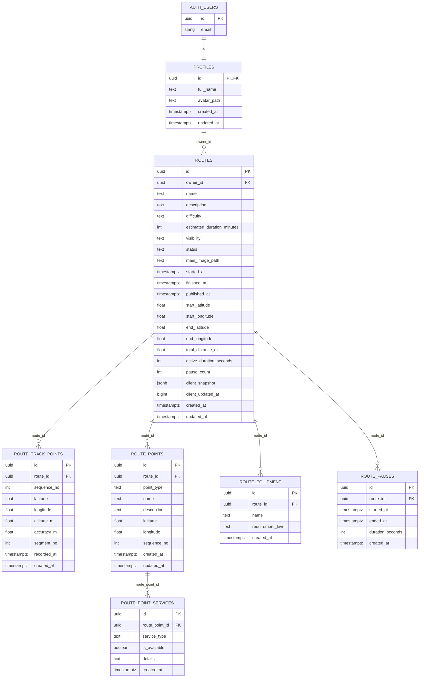
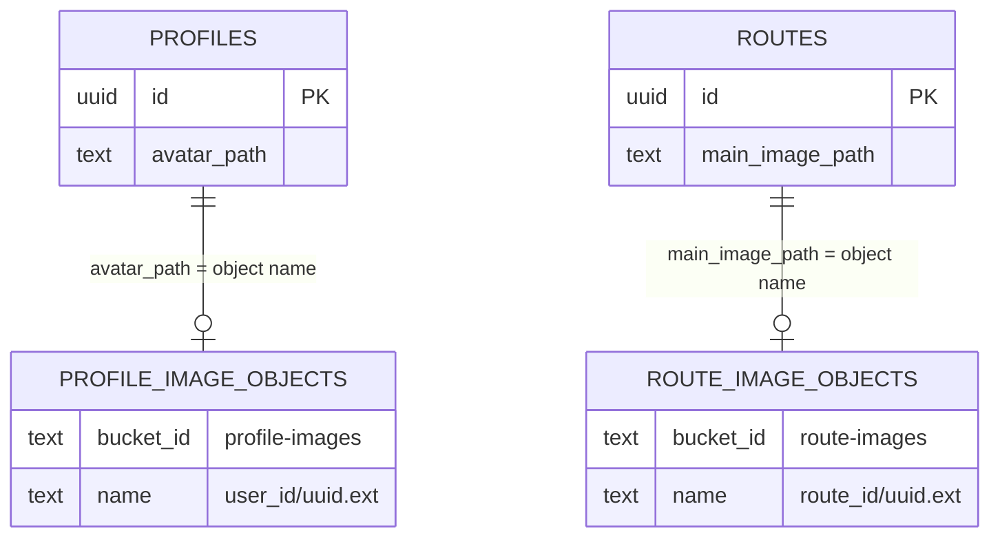

# Diagrama Entidad Relacion

Revision del proyecto Supabase `khhnfbwzxklzkegwfapd` al 2026-09-18.

## Auditoria De Tablas

Tablas de negocio en `public`:

| Tabla | Filas estimadas | Estado | Observacion |
| --- | ---: | --- | --- |
| `profiles` | 4 | Activa | Perfil creado desde Supabase Auth. |
| `routes` | 3 | Activa | Entidad principal de rutas grabadas/publicadas. |
| `route_track_points` | 13 | Activa | Puntos GPS del trazado. |
| `route_points` | 2 | Activa | Puntos manuales de ruta: campamento, descanso, agua, tienda u otro. |
| `route_point_services` | 3 | Activa | Servicios asociados a cada punto manual. |
| `route_equipment` | 7 | Activa | Equipo recomendado/indispensable por ruta. |
| `route_pauses` | 0 | Preparada | No tiene registros actualmente, pero esta relacionada con `routes` y cubre pausas/continuacion del recorrido. No es tabla muerta. |

Resultado:

- No hay tablas de negocio aisladas o sin relacion.
- `route_pauses` es la unica tabla vacia, pero tiene FK, RLS, indice y pruebas. Se conserva para HU-15/HU-16.
- `storage.objects` y `storage.buckets` son tablas internas de Supabase Storage. La app las usa para `route-images` y `profile-images`, pero no tienen FK directa hacia `public.routes` o `public.profiles`; la relacion se controla por path y politicas RLS.
- Las tablas internas vacias de Storage como `buckets_analytics`, `buckets_vectors`, `vector_indexes`, `s3_multipart_uploads` no son tablas de negocio de la app.

## Diagrama ER Principal

## Relacion Con Storage

Estas relaciones son logicas, no FK fisicas:

## Cardinalidades Relevantes

- Un usuario de Auth tiene exactamente un perfil.
- Un perfil puede tener muchas rutas.
- Una ruta puede tener muchos puntos GPS.
- Una ruta puede tener muchos puntos manuales.
- Un punto manual puede tener muchos servicios.
- Una ruta puede tener muchos equipos recomendados.
- Una ruta puede tener muchas pausas.
- Una ruta puede tener una foto principal mediante `main_image_path`.
- Un perfil puede tener una foto de perfil mediante `avatar_path`.

## Tablas A Conservar

Se recomienda conservar todas las tablas actuales de `public`.

`route_pauses` no tiene filas ahora, pero se justifica por:

- HU-15: pausar tiempo activo y distancia.
- HU-16: continuar ruta.
- Auditoria posterior de pausas reales.
- Posibilidad de dibujar segmentos o explicar huecos del GPS.

Si se decide no guardar pausas historicas, entonces `pause_count` y `active_duration_seconds` en `routes` bastarian para resumen, pero se perderia trazabilidad.
