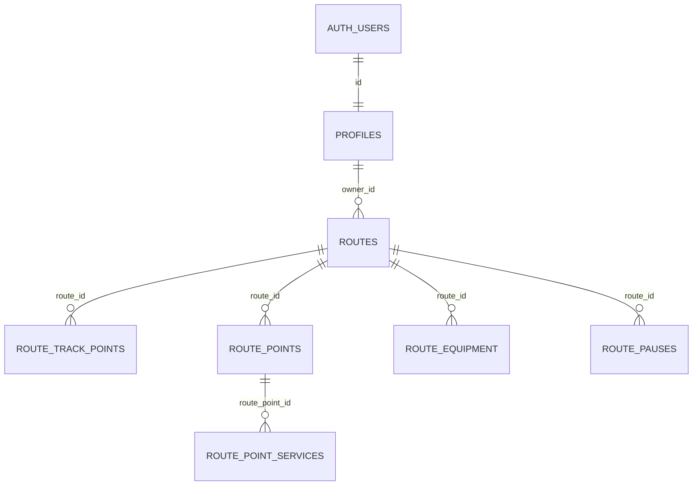

# Trekking Bolivia — base de datos V1

Alcance: RF-001/HU-01 a RF-025/HU-25. No incluye funciones sociales, administración, eventos, notificaciones, ranking ni estadísticas avanzadas.

## 1. Auditoría y despliegue

- Rama inicial: `Josue-Maydana`; árbol Git limpio antes de esta tarea.
- Expo `~57.0.22`, React Native `0.86.3`, React `19.2.3` y TypeScript `~6.0.3` estricto.
- Entrada `expo-router/entry`; rutas en `src/app/`, pestañas nativas y variante web. Starter conservado.
- No existían Supabase, migraciones, cliente, Auth, variables de entorno ni lógica de Trekking.
- Había script `lint`, pero no ESLint ni configuración.
- Se leyó la documentación exacta de Expo 57 antes de escribir código.
- MCP respondió con `ninalb999's Org` (`qrcnccfbbxcjrgvjtrnl`) y dos proyectos ajenos: `portal-proyectos-universitarios` y `sistema-de-reciclaje`. No se modificaron.
- **Organización/proyecto/ref de Trekking: pendientes. Ninguna migración se ha aplicado remotamente.**
- CLI `2.117.0` inicializada. Listar proyectos por CLI requiere `supabase login` / `SUPABASE_ACCESS_TOKEN`; la sesión MCP es independiente.
- No hay Docker ni PostgreSQL global. La alternativa de validación usa PostgreSQL 17 temporal y contratos SQL mínimos de Auth/Storage.

Los resultados comprobados se registran en [supabase_validation.md](./supabase_validation.md).

## 2. Arquitectura y relaciones

Supabase Auth conserva credenciales y email. La app utiliza la API con clave pública y JWT de sesión. PostgreSQL aplica RLS; Storage consulta la misma propiedad y visibilidad de rutas.



Todas las FK del diagrama usan `ON DELETE CASCADE`. Los objetos binarios de Storage no participan de esta cascada: se eliminan por Storage API antes de borrar la ruta.

| Tabla | Contenido |
| --- | --- |
| `profiles` | ID de Auth, nombre, avatar_path, fechas. Sin email duplicado ni contraseña. |
| `routes` | Propietario, datos generales, dificultad, estado, visibilidad, path de imagen, fechas, coordenadas inicial/final y resumen. |
| `route_track_points` | Muestras GPS automáticas: orden, coordenadas, altitud, precisión y fecha de captura. |
| `route_points` | Lugares manuales: tipo, nombre, descripción, coordenadas y orden opcional. |
| `route_point_services` | Servicios, disponibilidad y detalles; un servicio de cada tipo por punto. |
| `route_equipment` | Una fila por equipo; required o recommended. |
| `route_pauses` | Inicio, fin opcional y segundos opcionales. Información interna del propietario. |

**GPS y puntos manuales no se mezclan.** El trazado se reconstruye por `sequence_no`, sin guardar una cadena JSON en `routes`.

### Restricciones y decisiones

- Visibilidad: `private` inicial o `public`. Estado: `recording` inicial, `draft`, `published`.
- `difficulty`: texto nullable sin ENUM, escala ni cálculo automático.
- Tipos de punto: campamento, descanso, agua, tienda, otro.
- Servicios: water, signal, lodging, shop. Se amplían con una migración del CHECK sin rediseñar la tabla.
- Latitudes [-90,90], longitudes [-180,180]; distancia finita y no negativa; tiempos, conteo de pausas, precisión y secuencias no negativos.
- UNIQUE `(route_id, sequence_no)` en GPS; UNIQUE `(route_point_id, service_type)` en servicios.
- El fin de una pausa no precede a su inicio. La app calcula el resumen y mantiene coherentes los derivados.
- No se exige nombre/dificultad/imagen mientras se graba. No se inventaron campos obligatorios de publicación.
- La imagen principal debe usar su propio directorio: `<route_id>/<uuid>.<extension>`. No es una FK de Storage: subir el objeto antes de guardar el path.

## 3. Migraciones, índices y triggers

| Migración | Responsabilidad |
| --- | --- |
| `20260915045025_profiles.sql` | Perfil, funciones privadas, trigger de alta y backfill seguro de usuarios previos. |
| `20260915045027_routes.sql` | Rutas, restricciones, índices y fecha de actualización. |
| `20260915045030_route_tracking.sql` | GPS y orden único. |
| `20260915045034_route_points.sql` | Puntos manuales y servicios. |
| `20260915045037_route_equipment.sql` | Equipo. |
| `20260915045040_route_pauses.sql` | Pausas. |
| `20260915045043_rls.sql` | Permisos explícitos y 26 políticas RLS de V1. |
| `20260915045047_storage.sql` | Bucket privado, parser de paths y cuatro políticas de Storage. |

Se crearon con `supabase migration new`. No hay DROP de tablas ni reset remoto. Se aplican una vez mediante el historial de Supabase; no se ocultan conflictos de tablas existentes. RLS se habilita en la migración que crea cada tabla, antes de otorgar permisos.

Índices adicionales a las siete PK:

| Índice | Columnas |
| --- | --- |
| routes_owner_id_idx | owner_id |
| routes_visibility_status_idx | visibility, status |
| routes_created_at_idx | created_at DESC |
| routes_difficulty_idx | difficulty |
| route_track_points_route_sequence_key | UNIQUE route_id, sequence_no |
| route_points_route_id_idx | route_id |
| route_point_services_point_type_key | UNIQUE route_point_id, service_type |
| route_equipment_route_id_idx | route_id |
| route_pauses_route_id_idx | route_id |

Los UNIQUE ya indexan las FK respectivas; no se duplican índices. La búsqueda usa `ILIKE '%texto%'`. No se añadió un B-tree inútil para subcadenas ni una extensión sin datos que justifiquen su coste. Si crece el catálogo, medir con EXPLAIN y evaluar pg_trgm.

Funciones y triggers:

- `private.set_updated_at()`: reutilizada por `profiles_set_updated_at`, `routes_set_updated_at` y `route_points_set_updated_at`.
- `private.handle_new_user()`: `on_auth_user_created` crea el perfil con `raw_user_meta_data.full_name`. Es la única SECURITY DEFINER, restringida al trigger, search_path vacío y sin ejecución para clientes. Durante signup auth.uid() puede ser NULL: la identidad procede de NEW.id en auth.users.
- `private.route_image_route_id(text)`: SECURITY INVOKER, inmutable; valida el path y obtiene el UUID del primer segmento con storage.foldername. Los paths inválidos devuelven NULL sin error de cast.

`private` no se expone en la API. El metadata editable del usuario solo aporta su nombre visible, nunca autorización.

## 4. RLS y permisos

| Recurso | Lectura anon | Lectura autenticada | Escritura |
| --- | --- | --- | --- |
| profiles | Información básica | Información básica | UPDATE propio de full_name/avatar_path. INSERT por trigger; DELETE cliente denegado. |
| routes | Solo public + published | Públicas publicadas y todas las propias | INSERT/UPDATE/DELETE del propietario. |
| GPS, puntos, servicios, equipo | Si la ruta es pública publicada | Si la ruta es visible por RLS | Solo propietario. |
| route_pauses | Sin permiso | Solo propietario | Solo propietario. |
| route-images | Si la ruta es pública publicada | Ruta pública publicada o propia | Solo propietario. |

UPDATE incluye USING y WITH CHECK: no permite cambiar propietario ni mover hijos o imágenes a rutas ajenas. La lectura de hijos reutiliza la visibilidad RLS de la ruta; servicios consulta punto y ruta.

La API necesita GRANT además de RLS. Los permisos se revocan/conceden explícitamente solo sobre las siete tablas. Anon no tiene escritura; authenticated no tiene TRUNCATE. Se utiliza `(select auth.uid())`.

**UPDATE/DELETE no autorizado puede devolver cero filas sin error.** Confirmar filas afectadas usando select/conteo; ausencia de error no demuestra una modificación.

## 5. Storage

Bucket `route-images` con `public=false`. Políticas: `route_images_read`, `route_images_insert_own`, `route_images_update_own` y `route_images_delete_own`. El propietario también tiene SELECT, necesario para reemplazos con upsert.

- Guardar solo main_image_path, nunca URL completa.
- Generar UUID para cada archivo.
- En React Native subir bytes ArrayBuffer; no depender de Blob/FormData para upload.
- Descargar con `supabase.storage.from('route-images').download(path)`: la API aplica la sesión/clave pública y RLS, también para visitantes sin login.
- No usar getPublicUrl porque el bucket es privado.
- Cada nueva petición consulta la visibilidad actual. Limpiar imágenes locales/caché cuando cambie sesión o visibilidad.
- Una URL firmada ya emitida sigue válida hasta expirar aunque la ruta cambie a privada. No se incorporó un helper que emita enlaces duraderos; definir una vigencia corta si se usan después.
- No se fija un límite funcional de fotografías. El límite local 50MiB generado por CLI es técnico, no una decisión definitiva de producto.
- Antes de borrar la ruta, eliminar sus objetos por Storage API. Si se borra primero, quedan inaccesibles por RLS y requieren limpieza de backend. Borrar metadatos SQL no elimina el archivo físico.

## 6. Cliente Expo y Auth

- `src/lib/supabase.ts`: getSupabase crea una única instancia createClient<Database>.
- `src/lib/auth.ts`: signUp(email,password,fullName), signInWithPassword(email,password), signOut, getSession.
- `src/hooks/use-supabase-auto-refresh.ts`: AppState con cleanup; montado una vez en el layout.
- `src/app/_layout.tsx`: únicamente incorpora el hook. Sin cambios visuales.
- `src/types/database.ts`: generado por introspección, sin interfaces manuales.
- `src/types/expo-env.d.ts`: referencia a los tipos oficiales de Expo para que CSS esté tipado incluso antes de ejecutar expo start.

Paquetes nuevos fijados:

| Uso | Paquete | Versión |
| --- | --- | --- |
| App | @supabase/supabase-js | 2.116.0 |
| App | @react-native-async-storage/async-storage | 2.2.0 |
| App | react-native-url-polyfill | 4.0.0 |
| Desarrollo | supabase CLI | 2.117.0 |
| Desarrollo | eslint | 9.39.5 |
| Desarrollo | eslint-config-expo | 57.0.2 |
| Pruebas aisladas | embedded-postgres | 17.10.0-beta.17 |
| Generador oficial | @supabase/postgrest-typegen | 0.2.1 |

AsyncStorage persiste la sesión nativa; web usa el almacenamiento del SDK. AsyncStorage no cifra la sesión en reposo; cifrarla requiere una decisión posterior. La app no guarda contraseñas.

La inicialización diferida permite abrir el starter sin variables. Intentar Auth sin configuración devuelve un error explícito. No hay claves inventadas ni un proyecto de respaldo.

```ts
import { signUp, signInWithPassword, signOut, getSession } from '@/lib/auth';

// Presentar los errores del SDK. Signup puede dar session=null si exige confirmación.
await signUp(email, password, fullName);
await signInWithPassword(email, password);
const { data: { session }, error } = await getSession();
await signOut();
```

getSession sirve para estado local; RLS es el control de permisos. No se implementaron pantallas ni grabación GPS.

### Variables

Copiar .env.example a .env.local:

```dotenv
EXPO_PUBLIC_SUPABASE_URL=
EXPO_PUBLIC_SUPABASE_ANON_KEY=
```

La segunda acepta la clave **publishable** recomendada o legacy anon; conserva el nombre pedido. Ambas se incluyen en el bundle público de Expo: nunca colocar service_role, sb_secret_, tokens personales ni contraseña de DB. Reiniciar Expo al cambiarlas.

.gitignore excluye .env, .env.* excepto .env.example, estado de Supabase y artefactos de pruebas.

Auth local conserva email habilitado y confirmación desactivada para desarrollo. Revisar confirmación/redirects del proyecto remoto al crearlo. No hay pantallas/callbacks de confirmación, recuperación ni OAuth todavía.

## 7. Grabación, finalización y guardado

1. Signup → trigger crea profiles.
2. Crear ruta propia recording + private; guardar started_at y posición inicial.
3. Agregar GPS con UUID estables y sequence_no creciente. Para reintentos, upsert con onConflict route_id,sequence_no.
4. Agregar lugares en route_points y servicios en route_point_services.
5. Pausar: abrir route_pauses y suspender acumulación de tiempo/distancia en la app. Continuar: completar fin y segundos de pausa.
6. Finalizar: posición final, finished_at, distancia, tiempo activo y pausas; cambiar a draft.
7. Completar datos, dificultad libre, duración estimada, equipo; subir imagen y guardar path.
8. Esperar confirmación de **todas** las escrituras antes del estado final.
9. Privada: mantener private. Publicar: actualizar juntos visibility=public, status=published, published_at.

Las escrituras REST separadas no forman una transacción entre tablas. Mantener la ruta privada hasta el último UPDATE evita publicar información parcial; UUID estables permiten reintentar. No se añadió RPC compleja ni sincronización offline. Para editar varios recursos de una ruta pública de forma privada, ocultarla primero.

La app calcula métricas y descuenta pausas. No hay algoritmo de dificultad, filtro GPS ni pausa automática. Queda pendiente decidir cómo dibujar segmentos que cruzan pausas; las muestras conservan orden/tiempo y el propietario tiene los intervalos.

## 8. Consultas

```ts
const supabase = getSupabase();

let catalog = supabase.from('routes')
  .select('id,name,difficulty,main_image_path,total_distance_m,active_duration_seconds')
  .eq('visibility', 'public').eq('status', 'published')
  .order('created_at', { ascending: false }).order('id').range(0, 19);
if (search) catalog = catalog.ilike('name', '%' + search + '%');
if (difficulty) catalog = catalog.eq('difficulty', difficulty);
const { data, error } = await catalog;

// userId procede de la sesión. RLS sigue imponiendo la propiedad.
await supabase.from('routes').select('*').eq('owner_id', userId)
  .order('created_at', { ascending: false }).range(0, 19);

// Mapa: obtener TODAS las páginas GPS; max_rows de API es 1000.
await supabase.from('route_track_points').select('*').eq('route_id', routeId)
  .order('sequence_no').gt('sequence_no', lastSequence).limit(1000);
await supabase.from('route_points').select('*,route_point_services(*)')
  .eq('route_id', routeId).order('sequence_no', { nullsFirst: false });
```

GPS: iniciar lastSequence=-1, repetir hasta página vacía, actualizar al último valor recibido y concatenar. No usar una sola petición de 1000 filas para una ruta larga. La futura UI decidirá si %/_ son comodines o texto literal en la búsqueda.

## 9. Despliegue y tipos

### Remoto

1. Crear o identificar el proyecto correcto: recomendación Trekking Bolivia / trekking-v1, São Paulo (sa-east-1), sin contratar pago.
2. Introducir contraseña solo en Supabase, no en Git ni en el chat.
3. Dar acceso al conector, o autenticar la CLI:

```powershell
npx supabase login
npx supabase link --project-ref REF_REAL
npx supabase migration list
```

4. Inspeccionar primero esquema, historial, políticas y bucket existentes. Si ya hay tablas V1, compararlas y preparar reconciliación.
5. Revisar y aplicar:

```powershell
npx supabase db push --dry-run
npx supabase db push
npx supabase gen types typescript --linked --schema public > src/types/database.ts
```

Alternativa: MCP apply_migration/generate_typescript_types. Conservar archivos y reconciliar timestamps si el MCP asigna otros en el historial. Nunca editar una migración ya aplicada.

6. Ejecutar Security/Performance Advisors, [security_audit.sql](../supabase/tests/security_audit.sql) y pruebas HTTP del informe.

### Supabase completo local (requiere Docker)

```powershell
npx supabase start
npx supabase migration list --local
npx supabase gen types typescript --local --schema public > src/types/database.ts
```

No hay seed porque no se necesitan datos ficticios productivos. Consultar --help de la CLI instalada antes de usar opciones de otra versión.

### SQL sin Docker

```powershell
npm --prefix supabase/tests ci
npm run db:test
# Tras un cambio intencional del esquema:
npm run db:types
npm run typecheck
npm run lint
```

Las dependencias de prueba están aisladas en supabase/tests y no se empaquetan en móvil. El runner crea PostgreSQL 17 temporal, aplica migraciones e introspecta con el generador oficial @supabase/postgrest-typegen, utilizado por postgres-meta.

Cambia a roles anon/authenticated y verifica current_user, utiliza identidades aleatorias, savepoints y rollback de datos. El clúster queda detenido en .artifacts/pg-* para diagnóstico; resultados en .artifacts/results.json. Ambos ignorados por Git.

**Límite:** bootstrap.sql contiene contratos mínimos de auth.users, auth.uid y metadatos Storage. No aplicarlo en Supabase. Las pruebas verifican PostgreSQL/RLS, no GoTrue, PostgREST, email, archivos físicos ni dispositivos.

## 10. Matriz RF/HU

| RF/HU | Tabla/servicio Supabase |
| --- | --- |
| RF-001 / HU-01 | Auth signUp → trigger → profiles |
| RF-002 / HU-02 | Auth signInWithPassword y sesión |
| RF-003 / HU-03 | routes + SELECT público RLS |
| RF-004 / HU-04 | routes.name, ILIKE |
| RF-005 / HU-05 | routes.difficulty + índice |
| RF-006 / HU-06 | routes, profiles, route_equipment, route_points |
| RF-007 / HU-07 | main_image_path + route-images |
| RF-008 / HU-08 | routes.status=recording, started_at |
| RF-009 / HU-09 | start_latitude/start_longitude + primera muestra GPS |
| RF-010 / HU-10 | route_track_points |
| RF-011 / HU-11 | total_distance_m/active_duration_seconds; cálculo en app |
| RF-012 / HU-12 | route_points |
| RF-013 / HU-13 | route_points.point_type |
| RF-014 / HU-14 | route_points + route_point_services |
| RF-015 / HU-15 | route_pauses.started_at; suspensión en app |
| RF-016 / HU-16 | route_pauses.ended_at/duration_seconds |
| RF-017 / HU-17 | finished_at, posición final, status=draft |
| RF-018 / HU-18 | Resumen routes + route_pauses; cálculo en app |
| RF-019 / HU-19 | routes + route_equipment |
| RF-020 / HU-20 | Storage privado + main_image_path |
| RF-021 / HU-21 | routes.visibility |
| RF-022 / HU-22 | routes y tablas hijas; publicar tras guardar |
| RF-023 / HU-23 | routes public + published |
| RF-024 / HU-24 | routes.owner_id=auth.uid() + índice |
| RF-025 / HU-25 | routes + GPS ordenado/paginado + route_points |

## 11. Pendientes y fuentes

Pendientes: escala/algoritmo de dificultad; filtros GPS; validaciones finales de publicación; límites definitivos de fotografías; tratamiento visual de pausas; confirmación/redirects de Auth; cifrado de sesión; recuperación offline y atomicidad multitabla si se requieren. No se agregaron servicios fuera de los cuatro validados ni roles administrativos.

Referencias consultadas:

- [Expo 57](https://docs.expo.dev/versions/v57.0.0/).
- [AsyncStorage de Expo 57](https://docs.expo.dev/versions/v57.0.0/sdk/async-storage/).
- [Auth React Native](https://supabase.com/docs/guides/auth/quickstarts/react-native).
- [GRANT explícito de Data API](https://supabase.com/changelog/45329-breaking-change-tables-not-exposed-to-data-and-graphql-api-automatically).
- [RLS](https://supabase.com/docs/guides/database/postgres/row-level-security).
- [Storage](https://supabase.com/docs/guides/storage/security/access-control).
